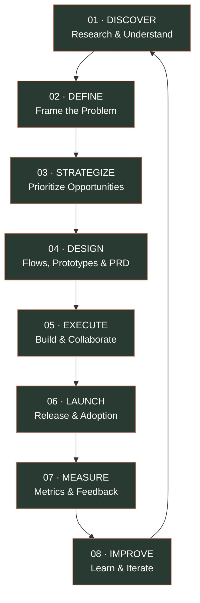

<!-- ====================================================== -->
<!-- SAIM HASAN | PRODUCT MANAGEMENT PROFILE                -->
<!-- ====================================================== -->

# Hi, I'm Saim Hasan 👋

### Product Manager · Product Strategy · Product Execution

 

  

  

*Understanding problems. Making informed decisions. Creating meaningful product experiences.*

---

<b>🧭 Explore This Profile</b>

- [About Me](#-about-me)
- [Product Management Skill Set](#-product-management-skill-set)
- [Product Frameworks](#-product-frameworks--methodologies)
- [Product Development Lifecycle](#-how-i-approach-product-development)
- [Product Tools](#️-product-tools--technology)
- [Featured Product Case Study](#-featured-product-case-study)
- [Product Metrics](#-product-analytics--metrics)
- [Technical Understanding](#-technical-understanding)
- [GitHub Analytics](#-github-analytics)
- [Let's Connect](#-lets-connect)

---

## 👨‍💻 About Me

I'm Saim Hasan, interested in building products at the intersection of **user needs, business objectives, design, and technology**.

My approach to product management starts with understanding the problem before deciding what to build.

I focus on connecting product discovery with strategic decision-making and execution — translating user insights into clear requirements, prioritizing opportunities, collaborating with cross-functional teams, and evaluating outcomes through meaningful metrics.

My areas of interest include:

- Product strategy and product vision
- User research and problem validation
- Product discovery and opportunity assessment
- Product roadmapping and prioritization
- UX collaboration and product prototyping
- Agile product development and execution
- Product analytics and continuous improvement
- AI-powered products and responsible AI

I believe a successful product is not defined by the number of features delivered, but by the value it creates for its users and the business.

---

## 🎯 Product Management Skill Set

<b>01 · Product Strategy & Product Thinking</b>

- Product vision and mission
- Product lifecycle management
- Business objectives and alignment
- Market and competitor analysis
- SWOT analysis
- Porter's Five Forces
- Product positioning and differentiation
- Desirability, Viability and Feasibility
- Product opportunity assessment
- Strategic trade-off decisions

<b>02 · Product Discovery & User Research</b>

- User research planning
- Customer pain-point identification
- Jobs To Be Done (JTBD)
- User and problem interviews
- Research question design
- Customer journey mapping
- Problem statement development
- Assumption mapping
- Evidence-based problem validation
- Qualitative research synthesis
- Prototype usability testing
- Customer feedback analysis

<b>03 · Prioritization & Product Planning</b>

- Product roadmap development
- MVP and feature scoping
- RICE prioritization
- MoSCoW prioritization
- Kano model
- Impact and effort assessment
- Product backlog management
- Opportunity prioritization
- OKRs and key results
- Scope and dependency management
- Product decision documentation

<b>04 · Product Design & Requirements</b>

- User flow development
- Wireframing and prototyping
- UX collaboration
- Feature specification
- Product Requirement Documents (PRDs)
- User story writing
- INVEST principles
- Acceptance criteria
- Story mapping
- Functional and non-functional requirements
- Edge-case identification
- Design-to-development handoff

<b>05 · Agile Product Development & Execution</b>

- Agile methodologies
- Scrum fundamentals
- Kanban workflow management
- Lean product principles
- Sprint planning
- Backlog refinement
- Release planning
- Cross-functional coordination
- Capacity and dependency planning
- QA and release readiness
- Risk identification and mitigation
- Post-release monitoring

<b>06 · Stakeholder & Team Communication</b>

- Stakeholder mapping
- Power-interest analysis
- Cross-functional collaboration
- Product decision communication
- Executive updates
- Engineering and design alignment
- Product documentation
- Risk and dependency communication
- Decision logs
- Feedback and expectation management

<b>07 · Product Analytics & Data-Informed Decisions</b>

- Product KPIs and OKRs
- North Star Metric
- AARRR framework
- Funnel analysis
- Cohort analysis
- Activation and retention
- Conversion measurement
- Quantitative and qualitative analysis
- Product dashboards
- Data interpretation
- Data storytelling
- Root Cause Analysis
- Continuous product improvement

<b>08 · Growth, GTM & Product Launch</b>

- Go-to-Market planning
- Market segmentation
- Product positioning
- Value proposition
- Launch readiness
- Adoption and engagement
- Customer feedback loops
- Growth opportunities
- CAC and LTV fundamentals
- Post-launch evaluation
- Cross-functional growth execution

---

## 🧩 Product Frameworks & Methodologies

| Area | Frameworks / Methods |
|---|---|
| Product strategy | SWOT, Porter's Five Forces |
| Product discovery | JTBD, User Interviews, Assumption Mapping |
| Prioritization | RICE, MoSCoW, Kano |
| Product planning | OKRs, Now-Next-Later Roadmap |
| UX & requirements | User Journey, Story Mapping, INVEST |
| Product execution | Agile, Scrum, Kanban, Lean |
| Stakeholder management | Power-Interest Matrix |
| Product analytics | North Star Metric, AARRR, Funnel, Cohort |
| Problem solving | 5 Whys, Fishbone, Pareto |
| Growth | Segmentation, Positioning, CAC/LTV |
| Interview & career | STAR, Product Sense, Case Interviews |

---

## 🔄 How I Approach Product Development

**My decision-making lens:**

- **Desirability:** Does this solve a meaningful user problem?
- **Viability:** Does it support a sustainable business objective?
- **Feasibility:** Can the team build and maintain it?
- **Responsibility:** Is it safe, accessible, fair and privacy-conscious?

---

## 🛠️ Product Tools & Technology

### Product Management & Collaboration

### UX, Research & Prototyping

### Product Analytics & Business Intelligence

### Technical Collaboration & Monitoring

### Creative & Professional Tools

---

## 🚀 Featured Product Case Study

### BandPath — IELTS Learning Platform

Product management field project · Feature-first product development

**Product concept**

BandPath is an IELTS learning platform concept focused on helping learners improve their preparation experience.

Rather than attempting to build an entire platform at once, the product approach focuses on validating and developing one meaningful feature at a time.

**Initial product focus**

Speaking Practice → Recording → Feedback → Next Practice

**Problem hypothesis**

IELTS learners may struggle to maintain consistent speaking practice and receive specific, actionable feedback.

**Target user hypothesis**

Mobile-first IELTS self-learners, initially exploring learners around Band 5.5–6.5.

### Product Strategy

- Start with a focused user segment.
- Understand actual speaking practice challenges.
- Validate assumptions through research.
- Define a narrow MVP scope.
- Build a testable user experience.
- Measure meaningful learning behavior.
- Iterate using evidence and feedback.

### Core Product Deliverables

| Product Area | Deliverable |
|---|---|
| Discovery | Problem brief and interview guide |
| Research | Evidence log and user insights |
| Strategy | Feature prioritization and MVP scope |
| Design | User flows and clickable prototype |
| Requirements | PRD, stories and acceptance criteria |
| Execution | Backlog and release plan |
| Analytics | Event tracking and funnel dashboard |
| Improvement | Feedback, issue log and iteration plan |

### North Star Metric

Weekly learners completing at least three meaningful speaking practice sessions.

**Important:** This is a proposed product metric, not a claim of measured user performance.

---

## 📈 Product Analytics & Metrics

I focus on understanding product performance beyond surface-level activity.

| Metric Category | Example Metrics |
|---|---|
| Acquisition | Traffic, source, sign-up conversion |
| Activation | First meaningful practice completed |
| Engagement | Practice frequency, sessions per user |
| Retention | Weekly and monthly returning learners |
| Revenue | Conversion, CAC, LTV |
| Quality | Upload success, feedback quality, latency |
| Reliability | Error rate, availability, incident frequency |

### Product Measurement Approach

1. Define the desired user outcome.
2. Select a meaningful success metric.
3. Establish the baseline.
4. Track the user journey and conversion funnel.
5. Analyze qualitative and quantitative evidence.
6. Identify bottlenecks and root causes.
7. Prioritize the next improvement.

---

## 🔬 Problem Solving & Root Cause Analysis

<b>Explore my problem-solving methods</b>

- **5 Whys:** Trace recurring problems to underlying causes.
- **Fishbone Diagram:** Organize potential causes across categories.
- **Pareto Analysis:** Identify high-impact contributors.
- **Funnel Analysis:** Locate where users abandon a journey.
- **Cohort Analysis:** Understand behavioral differences over time.
- **Qualitative Synthesis:** Identify recurring themes from user feedback.

---

## ⚙️ Technical Understanding

I value technical literacy as an important part of product decision-making and cross-functional collaboration.

My technical learning interests include:

- Software Development Lifecycle (SDLC)
- Frontend and backend fundamentals
- API concepts and request-response behavior
- Database fundamentals
- Web application architecture
- Product instrumentation and event tracking
- QA, edge cases and release reliability
- AI feature evaluation and reliability

### Responsible AI Product Thinking

- AI output quality and evaluation
- Human review and feedback loops
- Privacy and informed consent
- Hallucination and reliability risks
- Latency and failure handling
- Responsible product claims
- Fallback experiences

---

## 📊 GitHub Analytics

  

---

## 🐍 Contribution Journey

---

## 🌐 Let's Connect

  

### "Great products start with the right problems."

